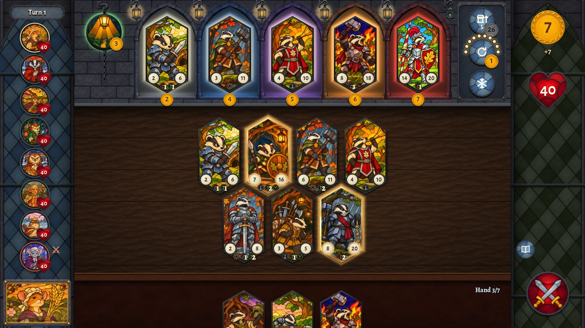

# Art direction: lead and stained glass

Decided by the owner on 15 November 2026. The owner's words are in [../owner-notes/2026-11-15b-stained-glass-direction.md](../owner-notes/2026-11-15b-stained-glass-direction.md). In short: "That is the direction we're going with. Lead and stained, like lead lining, stained glass." and "this is authoritative".

It replaces two earlier choices, which no longer hold: "flat figure" (earlier on 15 November; kept as history in [../../archive/flat-figure/](../../archive/flat-figure/ARCHIVED.md)) and "Ink + flat B" (1 November).

The card and the buy screen are the **L1 look**, which the owner chose on 24 November 2026 and had built in the game: its spec and the owner's decisions are in [../look-l1/](../look-l1/README.md). The recipe for making card art, approved by the owner on 16 November 2026, is in [card-art-recipe.md](card-art-recipe.md).

## What is decided

- **Cards and the whole UI are lead and stained glass.** The owner: "do up the UI with lead lining and stained glass art" and "I want the entire project to pivot around this."
- **The chosen concept picture** sets the style of the art. The owner picked it from six frame concepts: "The stained glass is absolutely amazing. I love it." Its tier borders are not the card.
- **The card is a window (L1).** One plain lead frame round the picture, drawn in code, the same at every tier and on every screen; the Attack and Health discs sit in its lower corners. The owner: "I agree with you that L1 is the best." Its points take a regular hexagon's angles and its ratio stays 0.56, 140 × 250 on the 1920 × 1080 stage (L8, L24).
- **Tier is light, not a mark on the card.** No tier mark on a board card; tier shows on hover (L3). In the shop each unit stands in an arch lit from behind in its tier's colour: grey, green, blue, purple, orange, red, calmer than in the paintings and stronger with tier, with tier 6 between tiers 4 and 5 in strength (L4, L5). The colour order is the owner's of 15 and 16 November, with tier 5 orange in place of yellow so that gold belongs to golden alone.
- **Golden is gilt and light.** A golden card's lead and disc rims turn to gilt, with a halo and a glint (the L1 look; spec section 6).
- **Light is made in the engine.** "There needs to be some sort of lighting effect in Godot rather than some sort of static asset. And the twinkles on the gold borders are going to fall into the same kind of bucket." (L38). No glow is painted into a picture.
- **The buy screen** is a dim church interior: a stone shop wall with five lit arches, an oak table for the board (four over three), a leather ledge for the hand, and a dim lancet window down each side. The owner: "Everything else is basically perfect. I really like this." (L42) and "Let's go with that and build it out in-game." (L44). Its pieces are painted per zone (L30) and live in `assets/glass/l1/`.
- **How fighters look in glass.** The owner wants warriors shown full body, not cute and not zoomed in. Their earlier words, from 14 and 15 November: "these are fighters. They're supposed to be warriors"; the old art was "far too big and zoomed in", "too cartoony and Disney-ish", with "Not enough ... actual arms and legs". How that is done in glass is the process in [card-art-recipe.md](card-art-recipe.md), which the owner asked to keep as it is (15 Nov: "This process is producing what I like").

### The chosen concept

The same fox card twice: tier 1 on the left, tier 6 on the right. The style of the glass is what was chosen; the game's card does not use these borders.

### The buy screen in the game

The L1 buy screen as built, with its light (25 November). The approved mock-up it was built from is [../look-l1/buy-screen-l1.jpg](../look-l1/buy-screen-l1.jpg).

## What is not decided yet

- **Calmer card art.** The owner on 24 November: "We need less bright backgrounds ... we need to set guidelines for background colours that are allowed per tribe, and I'd like a full colour palette guideline thing made up" (L6). It comes later: "I think card art replacement can happen later. We'll just replace the borders for now." (L51). Not started; it will change the card art recipe's prompt.
- **The fight screen in this look.** It keeps the earlier look's room (a window of three lights in stone) with the new card. The fight at this card size is not designed (L35).
- **What the L1 spec leaves undesigned:** about thirty states of the buy screen (frozen, empty slots, keyword marks, Discover and more) keep the earlier look as stand-ins ([spec section 11](../look-l1/buy-screen-l1.md)).
- **Tier without colour.** In the shop, tier is told by colour and strength of light alone; off the shop, by the hover's words. A cue that does not rest on colour is not designed.
- **Which tribe lives in which biome**, and the tribe list. The prompts below name biomes and six tribes to test the style; those are an agent's picks.
- **What "the setting" means.** The owner said "It's now the setting, right?". It is not settled whether that means only the game's look, or also its world.

## How it was made

All the glass pictures are made by Codex with its built-in image tool.

- **The concept.** [tools/art/prompts/glass-concept-frames.txt](../../../tools/art/prompts/glass-concept-frames.txt), item 2 (`frame-glass.png`). The other five items are the frame concepts that were not chosen.
- **The first full-screen mock-up's art** (the mock-up is archived in [../../archive/glass-first-look/](../../archive/glass-first-look/ARCHIVED.md)). Two Codex rounds, each with the chosen concept picture attached as a style reference. The prompts tell Codex to match its glass, lead and glow but not copy its hexagon, border, badges or fox.
  - [glass-u1.txt](../../../tools/art/prompts/glass-u1.txt), [glass-u2.txt](../../../tools/art/prompts/glass-u2.txt), [glass-u3.txt](../../../tools/art/prompts/glass-u3.txt): the 15 fighter pictures.
  - [glass-p1.txt](../../../tools/art/prompts/glass-p1.txt), [glass-p2.txt](../../../tools/art/prompts/glass-p2.txt): the 8 portraits.
  - [glass-s1.txt](../../../tools/art/prompts/glass-s1.txt): the spell pictures, the pane sheet, the roundels, a quarry field and a stone texture.
  - [glass-r2.txt](../../../tools/art/prompts/glass-r2.txt): round 2, the six tribe emblems.

  Every image was usable first time. All the prompts share one STYLE paragraph.

- **The L1 look's painted pieces** (wall, table, ledge, columns, arches, lanterns, coins and the rest): Codex rounds from the prompt files `looks/L1/prompts*.txt` on the branch `ideation/ui-ux`, cut out by `looks/L1/zone-pieces.py` there. The 20 the buy screen uses are in `assets/glass/l1/`.

To give a worker a style reference, put its full path in the worker's task, as step 2 of the [card art recipe](card-art-recipe.md) does with its guide.

## Files

- `examples/`: the chosen concept, the L1 buy screen in the game, and the card art recipe's pictures. `glass-mockup.jpg` is the first full-screen mock-up, which the owner note of 15 November links; its other pictures are archived ([../../archive/glass-first-look/](../../archive/glass-first-look/ARCHIVED.md)).
- `tools/art/prompts/glass-*.txt`: the prompts above.
- The full working files of the concept and the first mock-up (every raw Codex PNG, the frame concepts at full size, and the briefs the agents worked from) are on the Optiplex at `/data/bramble-art/stained-glass/`. The L1 look's working files are on the Optiplex at `/data/ui-ideation/looks/L1/`.
