# Art direction: flat figure

Decided by the owner on 15 November 2026: "Okay, that's our new art direction." and "I want this documented because that style is what I want to go with." The owner's words are in `../owner-notes/2026-11-15a-art-direction.md`. This replaces the 1 November choice (ink + flat colour, take B).

## What it is

A fighter drawn in flat, hard-edged shapes of full colour, shown full body and small in the frame, standing in a soft, layered, glowing picture of the place its tribe lives.

The owner's brief for it: "a similar art style to Ori and the Blind Forest, but remove detail ... less color gradients, more like just easier to execute for human artists ... Not as much detail ... Less intricate work." The mood is borrowed; no character or place from that game is copied.

## The six approved images

"that stuff is great. That is perfect."

| | | |
|---|---|---|
| 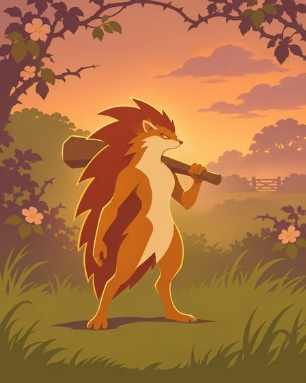 | 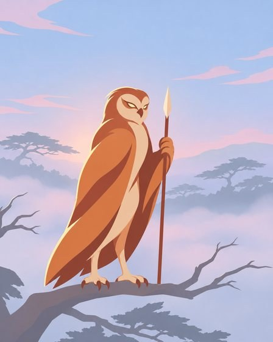 | 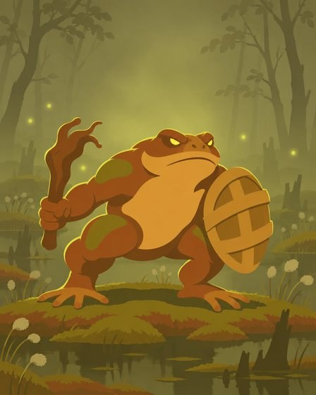 |
| Hedgehog, hedge bank at dusk | Owl, high canopy at dawn | Toad, peat bog in mist |
| 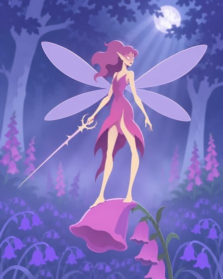 | 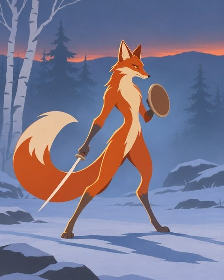 | 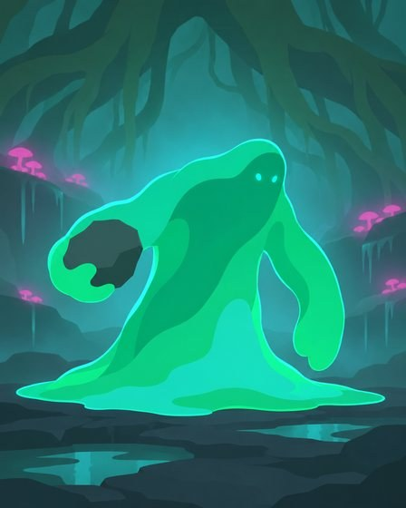 |
| Fairy duellist, moonlit bluebell glade | Fox, frosted upland at dusk | Ooze, hollow under roots |

## The rules that make it

These come from the fixed text above `Items:` in the prompt files. The owner's words are quoted where a rule comes straight from them.

**Framing**
- Tall portrait, 4:5. One creature.
- Full body, head to feet, with the ground under it. The old card art was "far too big and zoomed in".
- The figure is about 65% of the image height, with clear space above and below. Three-quarter view, camera pulled well back. Never a close-up or a bust.
- Limbs are clear in the silhouette. The old art had "Not enough ... actual arms and legs".

**Character**
- A fighter, not a mascot: lean, poised, serious. "these are fighters. They're supposed to be warriors".
- Not cute: no big head, no baby proportions, no smiles. Eyes are small, simple glowing shapes. The old art had "gone far too cartoony and Disney-ish".
- One simple weapon that reads in silhouette, and almost no other gear.
- Designed silhouette-first: a few large, smooth shapes with long curves and almost no interior detail. No fur strands, no single feathers, no stitching, no small ornaments. Recognisable from the black silhouette alone.

**Rendering**
- The character is only flat, hard-edged shapes: each shape one flat colour, one flat shadow shape, one thin flat coloured rim-light line. No gradients or texture on the character.
- Full natural colour. "the flat figure stuff's great, but they don't need to limit the color palette as much." The character is never a dark near-black silhouette.
- The character is clearly lighter and more saturated than the background behind it.
- The background is soft: three layers of the biome in silhouette and one soft misty glow behind the character. Colourful, not monochrome.
- Far less detail than a finished game painting.

**Biome**
- "I want the art to feel like different tribes should have different biomes that they inhabit, right? That are a natural fit for them."
- Every item names its biome. The background, the light and the whole palette come from it.
- Two different biomes never look like the same place or share a palette.

## Item recipe

Each numbered item in a prompt file is one line:

```
N. filename.png -- <creature and role>, <its one or two biggest shapes>, <one weapon and pose>. BIOME: <place, time of day or weather>: <four or five things in it>. Palette: <four colours>.
```

Example, from `direction-flat-a.txt`:

```
1. flat-hedgerow-hedgehog.png -- A hedgehog guardian, feet planted, its quills one big jagged crest shape down its back, a heavy wooden club resting on one shoulder. BIOME: an ancient hedge bank at golden dusk: arching bramble and hawthorn, dog-rose, tall meadow grass, a field gate far off. Palette: warm amber, honey gold, olive green, deep plum shadows.
```

What works:
- Name the creature's biggest shape ("quills one big jagged crest", "tail as one sweeping shape"). It keeps the silhouette simple.
- Give each biome a time of day or weather as well as a place. That is what keeps palettes apart.
- Fighters from the same tribe share the same BIOME and Palette text, word for word.
- Six items per batch.

## How to make more

To add a batch, copy a prompt file from `tools/art/prompts/direction-flat-*.txt`, keep everything above `Items:` unchanged, and write new items.

- **Optiplex (Linux):** `tools/art/run-flat-figure.sh c d` runs batches c and d side by side with Codex and attaches the six approved images as style references. PNGs go to `/data/bramble-art/flat-figure/out/<letter>/` (set `ART_OUT` to change it). A batch of six can take up to 40 minutes (the time limit), so run it in the background. The kit the first batches were made with is at `/data/bramble-art/flat-figure/` (its own `run.sh` does the same from that folder).
- **Windows:** `tools/art/run-codex-image.ps1 -PromptFile tools/art/prompts/direction-flat-c.txt -OutDir <dir>` runs one batch. It doesn't attach reference images, so results drift more.

Codex makes every image with its built-in image tool. Keep the PNGs as masters outside the repo, and commit JPEGs of about 448 x 560.

## What is decided and what is not

Decided by the owner:
- The style, as the six approved images show it. The written rules above are an agent's description of what produced those images, apart from the lines that quote the owner. The exact figures (65%, 4:5, three background layers and so on) are the agent's.
- Tribes live in different biomes that are a natural fit for them.

Not decided (an agent's picks):
- Which tribe gets which biome. The pairings in prompts a and b (hedgerow, canopy, bog, bluebell glade, frosted upland, root hollow) were written to test the style.
- The 12 further creatures and biomes below. The owner asked for "12 more with the same style"; which creatures and places was left to the agent.
- The tribe list itself. The names in the filenames are labels, not a roster.

## The 12 further images

Made on 15 November from prompts c and d, with three redone from prompt e.

| | | |
|---|---|---|
| 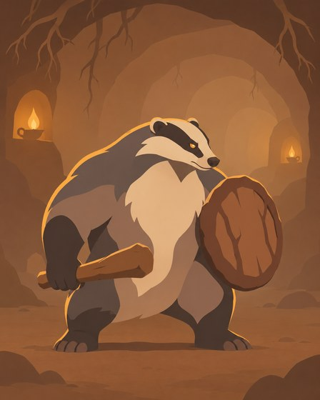 | 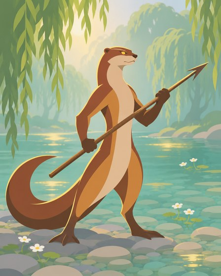 | 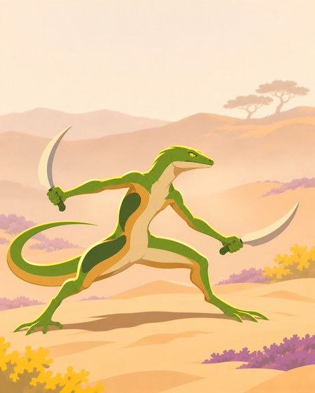 |
| Badger, earth burrow hall | Otter, chalk stream in the morning | Lizard, sandy heath at noon |
| 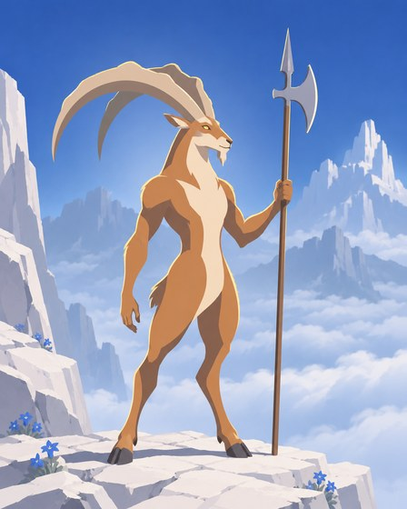 | 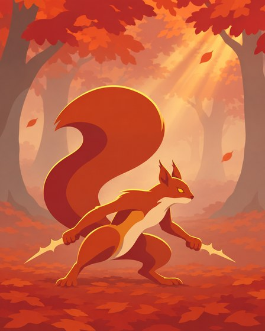 | 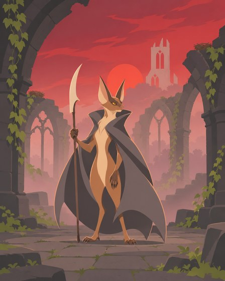 |
| Ibex, high crags above the clouds | Squirrel, autumn beechwood | Bat, ruined abbey at sunset (redone) |
| 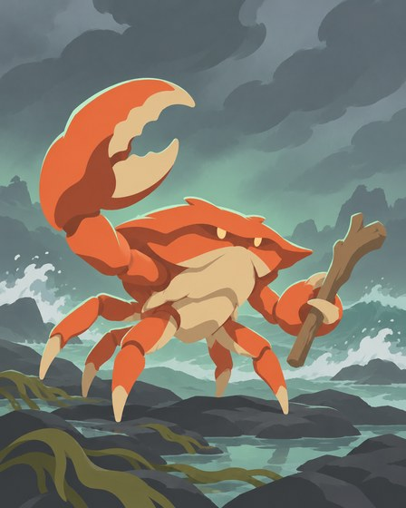 | 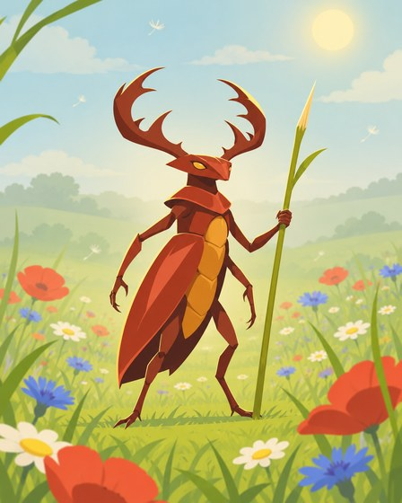 | 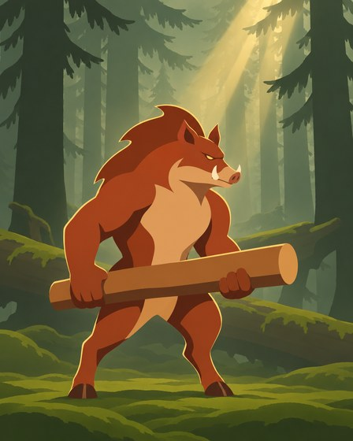 |
| Crab, tidal shore under a storm | Stag beetle, wildflower meadow at midday | Boar, old spruce forest (redone) |
| 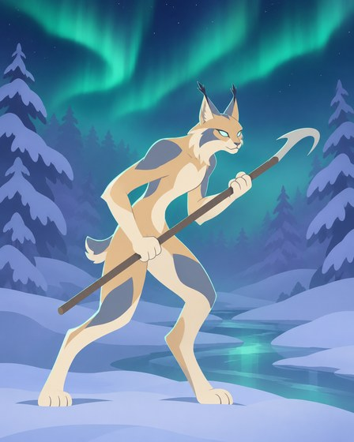 | 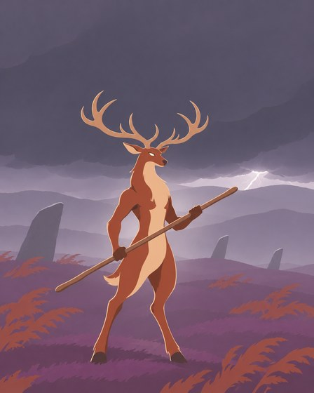 | 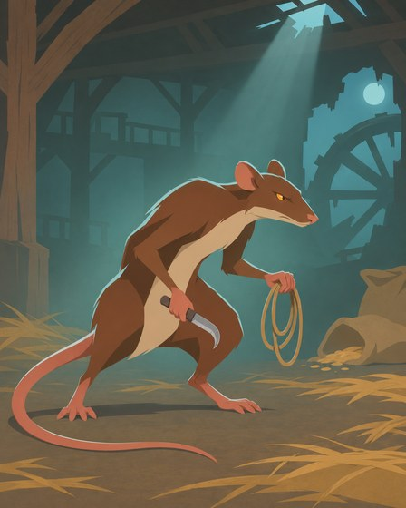 |
| Lynx, snow forest under the northern lights (redone) | Stag, moor under a storm | Rat, abandoned watermill at night |

An agent checked each one against the rules above; the owner has not seen them yet.

- Three were redone once, with a tighter item in prompt e. The bat's first try was one crimson all over and filled about 80% of the frame. The lynx was on all fours and small in the frame. The boar had fur-tuft edges and was darker than the light behind it.
- Still a little off: the redone lynx is about 75% of the frame height and the badger about 70%, both bigger than the 65% rule. The crab stands on all its legs, not upright. The redone bat's stonework has more detail than the approved six.

What the redos taught: when the creature's natural colour is close to its biome's palette, name the creature's colours in the item. And say "standing upright on its two hind legs" for any four-legged animal.

## Files

- `examples/`: the 18 images, JPEG, 448 x 560.
- `tools/art/prompts/direction-flat-a.txt`, `-b.txt`: the prompts that made the approved six, plus one more fighter per tribe that is not shown here.
- `tools/art/prompts/direction-flat-c.txt`, `-d.txt`, `-e.txt`: the 12 further images.
- `tools/art/run-flat-figure.sh`: the Linux runner.
