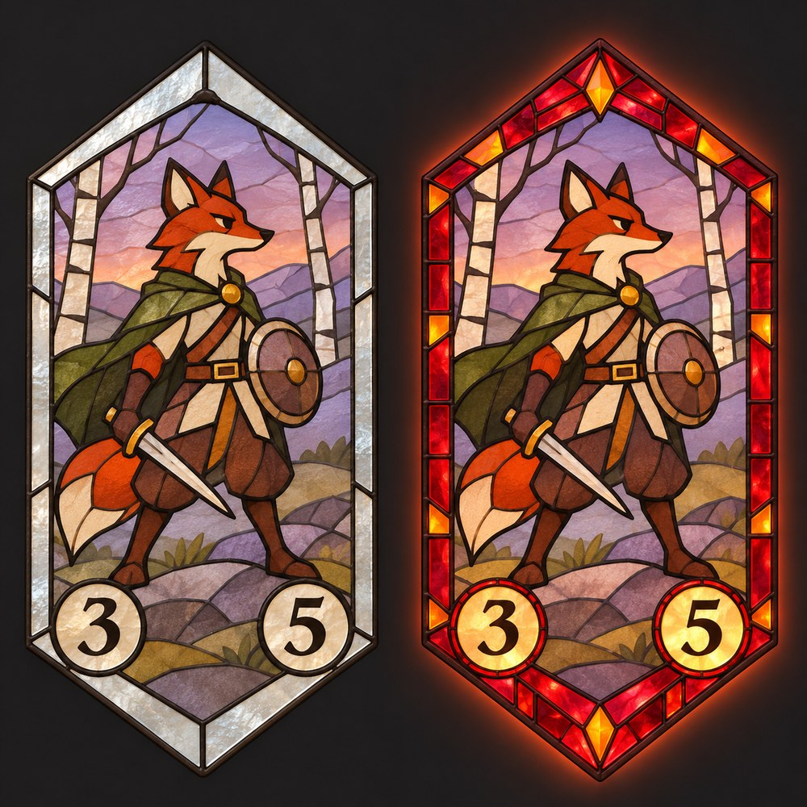
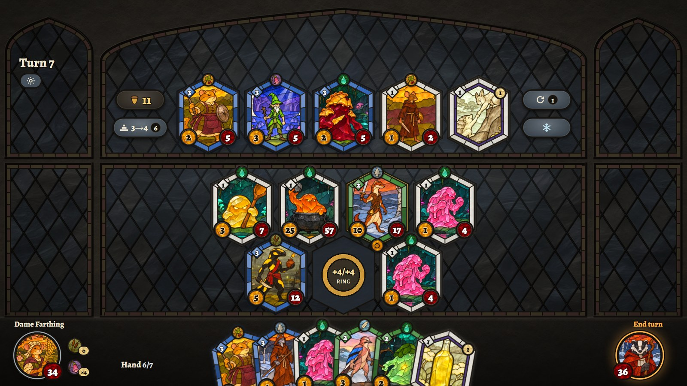
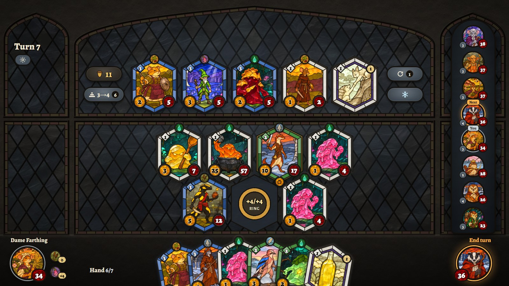
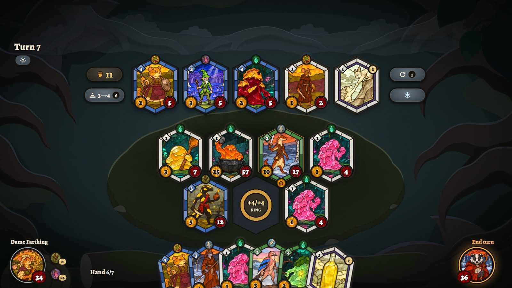
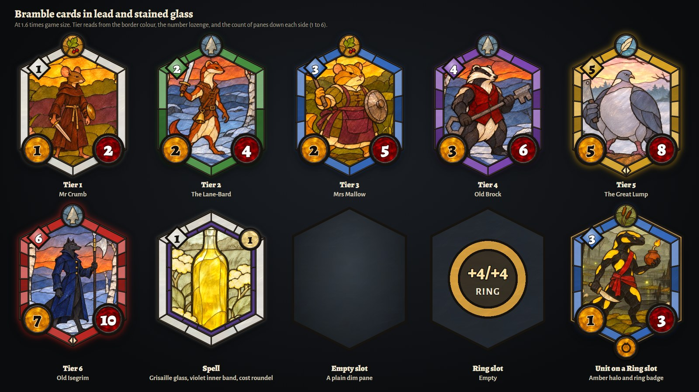

# Art direction: lead and stained glass

Decided by the owner on 15 November 2026. The owner's words are in [../owner-notes/2026-11-15b-stained-glass-direction.md](../owner-notes/2026-11-15b-stained-glass-direction.md). In short: "That is the direction we're going with. Lead and stained, like lead lining, stained glass." and "this is authoritative".

It replaces two earlier choices, which no longer hold: "flat figure" (earlier on 15 November; kept as history in [../../archive/flat-figure/](../../archive/flat-figure/ARCHIVED.md)) and "Ink + flat B" (1 November).

The owner approved a plan to dial the direction in on 15 November 2026: card frames and the screen first, then style rules and a guide. It is [../../workstreams/glass-dial-in.md](../../workstreams/glass-dial-in.md). Until its steps land, this page is the whole of what is decided.

## What is decided

- **Cards and the whole UI are lead and stained glass.** The owner: "do up the UI with lead lining and stained glass art" and "I want the entire project to pivot around this."
- **The chosen concept picture.** The owner picked it from six frame concepts: "The stained glass is absolutely amazing. I love it."
- **The full-screen mock-up is close.** The owner, after seeing it: "The UI is very close, so I just want to refine a few more things." Its layout keeps "the positioning and spacing we had before". Its details (see below) are an agent's choices, not decisions.

### The chosen concept

The same fox card twice: tier 1 on the left, tier 6 on the right.



### The mock-up

The recruit screen, leaderboard hidden. The screen is one window of three lights in dark stone; the cards are the bright panels.



The same screen with the leaderboard showing:



The same glass cards and UI over a dark woodland backdrop instead of the window, for comparing "one great window" with "glass pieces in the forest":



The card sheet, at 1.6 times game size: a unit at each tier 1 to 6, a spell, an empty slot, a Ring slot and a unit on a Ring slot.



## What is not decided yet

Everything below is open. The mock-up shows one agent's answer to each; none of them is chosen.

- **Card frame details.** The border, the lead pattern, the roundels for Attack and Health, the tribe emblem, how a spell differs from a unit. The owner: "get ready to lock in a bit more about how the card frames and stuff will look".
- **How tier is marked.** The mock-up uses the tier colours the owner asked for earlier on 15 November ("white, then green, then blue, then that purple, then like yellow for legendary and red for mythic", as quoted in the mock-up's brief, `BRIEF-GLASS.md` on the Optiplex), plus a number lozenge, a count of panes down each side, and a jewel and glow on tiers 5 and 6. Only the colour order is the owner's; the rest is the agent's.
- **Spacing refinements.** The owner: "a bit more of the spacing".
- **The window architecture.** Whether the screen is one window (the three lights in stone, as in the mock-up), glass pieces over a woodland backdrop, or something else; what the window is set in and what lights it.
- **How fighters look in glass.** The owner wants warriors shown full body, not cute and not zoomed in. Their earlier words, from 14 and 15 November: "these are fighters. They're supposed to be warriors"; the old art was "far too big and zoomed in", "too cartoony and Disney-ish", with "Not enough ... actual arms and legs". How that is done in glass is open.
- **Which tribe lives in which biome**, and the tribe list. The prompts below name biomes and six tribes to test the style; those are an agent's picks.
- **What "the setting" means.** The owner said "It's now the setting, right?". It is not settled whether that means only the game's look, or also its world. This is being asked.

## How it was made

All the glass pictures were made by Codex with its built-in image tool. The mock-up's own pages, lead lines, stone and pane field were built by an agent in HTML, SVG and Python on top of them.

- **The concept.** [tools/art/prompts/glass-concept-frames.txt](../../../tools/art/prompts/glass-concept-frames.txt), item 2 (`frame-glass.png`). The other five items are the frame concepts that were not chosen.
- **The mock-up's art.** Two Codex rounds, each with the chosen concept picture attached as a style reference. The prompts tell Codex to match its glass, lead and glow but not copy its hexagon, border, badges or fox.
  - [glass-u1.txt](../../../tools/art/prompts/glass-u1.txt), [glass-u2.txt](../../../tools/art/prompts/glass-u2.txt), [glass-u3.txt](../../../tools/art/prompts/glass-u3.txt): the 15 fighter pictures.
  - [glass-p1.txt](../../../tools/art/prompts/glass-p1.txt), [glass-p2.txt](../../../tools/art/prompts/glass-p2.txt): the 8 portraits.
  - [glass-s1.txt](../../../tools/art/prompts/glass-s1.txt): the spell pictures, the pane sheet, the roundels, a quarry field and a stone texture.
  - [glass-r2.txt](../../../tools/art/prompts/glass-r2.txt): round 2, the six tribe emblems.

  Every image was usable first time. All the prompts share one STYLE paragraph.

To attach a style reference, call Codex as [tools/art/run-codex-image.ps1](../../../tools/art/run-codex-image.ps1) does, adding `-i <image>` before the prompt:

```
codex exec -i <concept.png> --skip-git-repo-check -s workspace-write -C <out dir> <prompt text>
```

What the agent who built the mock-up found weak (from its notes):
- The centre arch is wide and flat; it reads as a vault more than a pointed window head.
- With the leaderboard hidden, the side lights are empty quarries; the top right is the quietest corner.
- The count of panes that marks tier is faint at game size on the darker tiers (blue, purple).
- The Ring slot's amber halo is close to End turn's amber accent.
- Many fighters and portraits are hedgerow amber; the leaderboard has three warm-orange roundels in a row.
- In the woodland version the glass cards have no frame or light of their own.

## Files

- `examples/`: JPEG copies of the concept and the four mock-up screenshots.
- `tools/art/prompts/glass-*.txt`: the prompts above.
- The full working files (the mock-up's HTML pages, every raw Codex PNG, its asset and build scripts, and the six frame concepts at full size) are on the Optiplex at `/data/bramble-art/stained-glass/`: `glass/` holds the mock-up (open `glass/scene.html`; `?openLb=strip` shows the leaderboard, `?bg=woods` the woodland backdrop), `frames/` the frame concepts, and the `BRIEF*.md` files the briefs the agents worked from.
