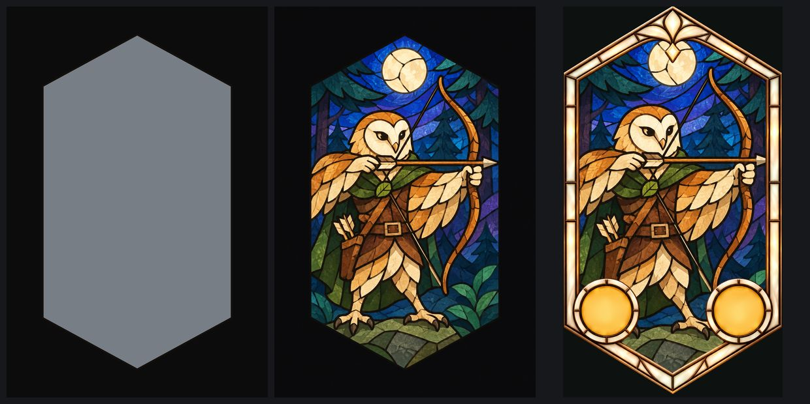
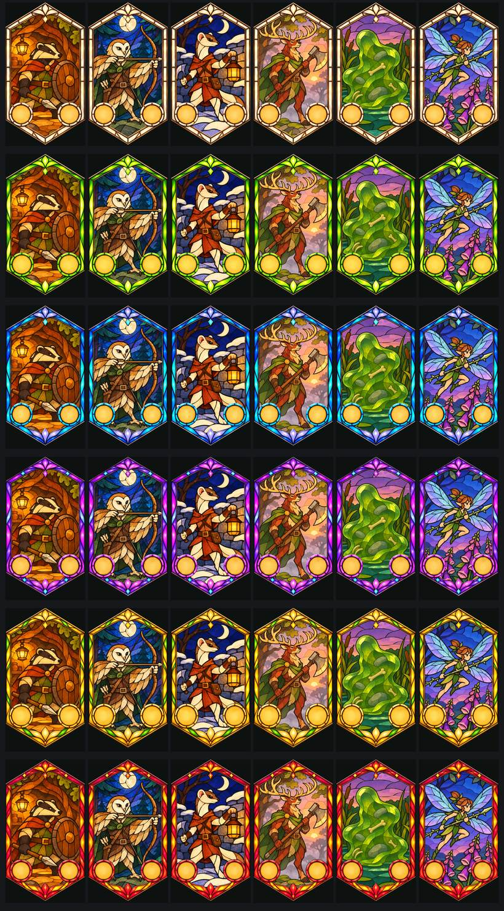

# Card art recipe: prompt, shape guide and assembly

**Draft: the owner has said the process is right, and has not yet approved this write-up for merging.** Written 15 November 2026 from the tests run that day. The owner, on reading it: "I just want the existing process captured. I don't want it changed. ... This process is producing what I like." The card shape and its window are a working spec, not locked: the owner, 15 Nov, "let's not be too rigid on anything yet until I'm absolutely certain that this method's going to work."

What this is for, in the owner's words (15 Nov): "our goal out of this is to get reproducible guides for prompting and card assembly so that we get consistent results".

## The method in one paragraph

A card is two pictures made separately. The **art** is a stained-glass picture of the fighter, made by Codex to the exact shape of the frame's window. The **frame** is the tier border, made once per tier (see [../../workstreams/glass-frames.md](../../workstreams/glass-frames.md)). To build a card, the art is moved into the card's coordinates by one fixed crop and the frame is laid on top. Nothing is scaled, moved or cropped by hand.



## What the owner has decided

- **The prompt is the loose one.** After two rounds of rule-heavy prompts came out worse than the first fox picture: "that prompt is going to be our process for image generation going forward, I think."
- **Art and frame are made apart.** The owner's reason: "We don't want the borders influencing the image generation's algorithm's choice of color palette." It began as a suggestion, "So maybe we just ask it to generate it a little bigger and then just overlay the borders ourselves on the images. I'm not sure." After seeing it work the owner backed the method built on it (below).
- **Art is made to the frame's window.** "Giving it the shape is good, but that shape needs to be the exact shape that fits in the inside of our frame", so that "we won't ever have to worry about scaling the image, moving it, positioning it, and cropping it."
- **The window is the plain frame's.** "the internal area for the simple frames that have the least thickness", "Ignoring any of the accents that get added and start overlaying onto the image in the higher tier frames."
- **This is the method to pursue.** "I think this approach is going to be the right method."
- **Fighters are warriors, shown full body.** The owner, 14 Nov: "these are fighters. They're supposed to be warriors"; the art before was "far too big and zoomed in", with "Not enough ... actual arms and legs".
- **Roundels may cover a little.** "It's not a massive deal if feet and tails get covered a little bit".
- **The process stays as it is, lead and glass included.** Asked which stands, an earlier rule or the pictures: "I changed my mind on that rule. We're getting good results out of the existing stuff. So the existing process, like I just want the existing process captured. I don't want it changed."
- **Each fighter is shown against a named place,** as in every test picture. It is part of the process the owner asked to keep. Before glass was chosen the owner had also said "I want the art to feel like different tribes should have different biomes that they inhabit". Which tribe has which place is still open.

## What this replaces

The owner, 15 Nov: "If previous stuff I've said overrides it, call it out like that. And let's get rid of it because it's wrong." These earlier statements no longer hold:

- **"Lines need to be flat black. They can't be anything except black."** and **"The streaky stuff is not needed. And the painted stuff is also not needed."** (the owner, 15 Nov, in chat, before seeing the loose-prompt results). Withdrawn by the owner: "I changed my mind on that rule." The process gives dark brown lead and streaky, back-lit glass, and that is what is wanted. These two statements were never written into the repo.
- **The style-rules step of the dial-in plan** ([../../workstreams/glass-dial-in.md](../../workstreams/glass-dial-in.md), step 4): trials to settle painted detail, lead weight and glass texture, then rules written from them. Two rounds of those trials were run and came out worse than the loose prompt. No style rules are being written. The step is marked as replaced in the plan.

One line of agent wording is also out of date and is updated with this recipe: [README.md](README.md) said of how fighters look, "How that is done in glass is open".

"The pieces", "Steps" and "What not to do" below are the process as it was run in the tests: the one the owner asked to have captured without change. The wording is the agent's. The test results and the "Not settled" list after them are the agent's report, not part of the process.

## The pieces

| Piece | Where | What it is |
|---|---|---|
| Card and window | [frame-lab/art-space.md](frame-lab/art-space.md) | Card 560 × 1000 (0.56 wide to 1 tall). Art window: a six-sided shape 498 × 895 inside it, set in `make_guide.py`. (art-space.md gives the same points in its opening note; the measurements under it are the earlier, smaller window.) |
| Shape guide | `tools/art/glass-art/guide.png` | A plain grey panel in the window's outline, on Codex's 1024 × 1536 canvas. Drawn by `make_guide.py`. |
| Prompt | `tools/art/prompts/glass-art-window.txt` | The loose wording plus the list of subjects. |
| Runner | `tools/art/run-codex-image.ps1` | Runs one batch through Codex with the guide attached. |
| Check and assembly | `tools/art/glass-art/assemble.py` | Measures each picture against the guide and builds the cards. |
| Frames | [frame-lab/final/](frame-lab/final/) | Six tier frames in card space, 1120 × 2000, window clear, roundels empty. The thin set the owner locked on 15 November, redrawn sharper the same day (the owner, relayed by the card frames session: "Yes, i approve"). |

The art window is the window of the outline the thin frames were drawn to (the frames the owner locked on 15 November, after finding the first set, in words relayed by the card frames session, "too busy now that I see them on screen. We need to reduce the width"). The frames' own windows are close to it: 1.6 to 3.3 card units inside it on every tier. So the guide adds 8 units on every side, which puts the art 9.6 units or more under the border everywhere (tier 4 has the least). Codex returns the panel within about 7 pixels (5 units) of the guide, sometimes smaller and sometimes larger. There is room on the other side too: the art would start to show past the frame's outer edge on tiers 3 and 4, near the lower-left corner, at a margin of about 13. These figures were measured on the frames as they are now. Measure again whenever the frame files change: a small change to a frame's edge can use up the room that is left. The card sits on Codex's canvas at 1.44 times spec size with its top-left corner at (108.8, 48). The card frames session said on 15 November that it would use the same placement for its own outline guides; that has not been checked against its files.

## Steps

1. **Write the items.** Copy `glass-art-window.txt` and change only the numbered list at the bottom. One line per picture:

   `name.png -- A <animal> <role>, full body, <what it holds or is doing>, against <a place and a time of day>.`

   A spell has no fighter: `spell.png -- A spell, with no fighter in it: <what happens>, <where>.` Six items a batch works well.

2. **Run it with the guide attached.** From the repo root:

   ```
   tools/art/run-codex-image.ps1 -PromptFile <your prompt> -OutDir <art folder> -Image <full path>\tools\art\glass-art\guide.png
   ```

   A batch of six takes about ten to fifteen minutes. Results differ from run to run, so run the same prompt two or three times into different folders and choose.

3. **Check and assemble.**

   ```
   python tools/art/glass-art/assemble.py <art folder> <cards folder> --tiers 1,6
   ```

   It prints, for each picture, how far the panel's four edges are from the guide's, and flags any that are more than 12 pixels off. The tightest frame, tier 4, has about 13.8 pixels of art to spare. The check measures the panel's left, top, right and bottom, not the sloping edges themselves. The guide is measured the same way as the pictures, so the guide itself reads 0 on every side. Make a flagged picture again. It then writes each card under each tier asked for.

4. **Look at the cards** under the highest tier the fighter could have, at the size they will be in the game.

## What not to do

- **Do not add style rules.** Lead weight, lead colour, glass texture, piece counts and palette limits were all tried on 15 November. Codex followed them literally and the pictures came out flat. The two short paragraphs that begin "Look:" and "The design" are the whole style.
- **Do not attach a finished card as a style reference.** A reference locks whatever is in it. With a finished fox card attached, every picture copied its border and roundels. The grey guide works because there is nothing in it but the shape.
- **Do not put the border or the numbers in the art.** They are added afterwards.
- **Do not fit a picture by hand.** If it is off the guide, make it again.

## What the tests showed

| Test | Pictures | Result |
|---|---|---|
| Loose prompt, six fighters, three runs with nothing attached and three with the fox attached | 36 | The look came back every time. Without the fox, borders varied from run to run; with it, they were identical. |
| Art without a border, three ways | 54 | All three kept the quality. A border is not needed to get the look. |
| Art to the window with the grey guide, six fighters, three runs | 18 | Every panel edge within 5 pixels of the guide's, from 2 outside it to 5 inside. The set includes night scenes, and the check read them correctly. |
| The same with awkward subjects: a stag with wide antlers, a boar on all fours, a small mouse, an ooze, a fairy with wings spread, a spell | 18 | Every panel edge within 5 pixels, from 1 outside to 5 inside. All six made clear cards under all six tier frames. |
| Art to the thin frames' bigger window: the six fighters and the six awkward subjects, two runs each, through the repo's runner | 24 | Every panel edge within 7 pixels of the guide's. No gaps seen under any of the six thin frames as first cut. |
| The same again to a guide with a 12-unit margin, under the sharper frames | 24 | Every panel edge within 7 pixels of the guide's. No gaps seen under any tier, or along tier 5's upper sloping edges in a close-up of all 24. |
| The same again to the guide with the 8-unit margin, after tier 5 was redrawn | 24 | Every panel edge within 6 pixels of the guide's. No gaps seen under any tier on the sheet below, or along the upper sloping edges of tiers 4 and 5 in close-ups of all 24. |

The two 18-picture tests were made to an earlier, smaller window, for thicker frames that have since been replaced. The first 24-picture test used a guide with a 4-unit margin; under the sharper frames that left a thin gap on tier 5's upper sloping edges, so the second used a 12-unit margin. The owner then had tier 5 redrawn to match the other tiers (below), and the margin was set to 8. The third 24-picture test uses the guide and frames described here.

Before the frames were thinned, the steps above were also run once exactly as written, to the earlier window, through the repo's runner and `assemble.py`, for a fighter not used before (a heron). The panel came back within 1 pixel of the guide and the cards assembled with no changes.

Six pictures from the third 24-picture test under all six frames, tier 1 at the top:



The full sets are on the Optiplex under `/data/bramble-art/stained-glass/` (`loose-prompt-test`, `window-art-test`; the three 24-picture sets are in `window-art-test/thin-frames`, `window-art-test/sharp-frames` and `window-art-test/margin-8`; the last holds the current pictures and cards).

## Not settled

- **The card shape and window** are a working spec (above).
- **Tier 5 was redrawn.** On the sharper frames its window was the only one that reached past the art window. Asked on 15 November whether to keep a wider guide or have tier 5's frame redrawn to match the other tiers, the owner said: "Redraw tier 5". The card frames session redrew it, and all six now sit inside the art window. Its roundels are a little bigger and higher than the other tiers'; the owner, relayed by that session: "but it'll do for now".
- **The roundels are empty.** The frames carry no numbers; the game draws Attack on the left disc and Health on the right. Each tier's disc centres and sizes are in [frame-lab/final/roundels.json](frame-lab/final/roundels.json). `assemble.py` does not draw numbers, so assembled cards show empty discs.
- **The roundels cover the lower corners.** Feet and tails often sit behind them. The two discs could be added to the guide so Codex keeps clear of them.
- **The top accent covers the middle of the window's top edge on every tier.** A small diamond hangs down to about 15% of the card's height at the centre. Something placed at the very top centre of a picture sits behind it. At the bottom point, tiers 2 to 6 have an accent too: down the centre their windows end at about 85 to 88% of the card's height, where tier 1's runs to 93.5%.
- **A large set has not been made.** The most made to one guide is 24, in two runs of 12 each time. Colour strength varies a little between runs, and that may show across a hundred cards.
- **Not judged at game size on the real screen.**
