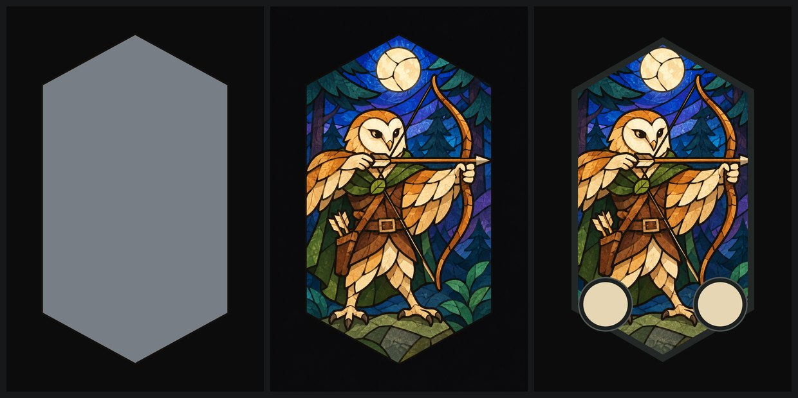
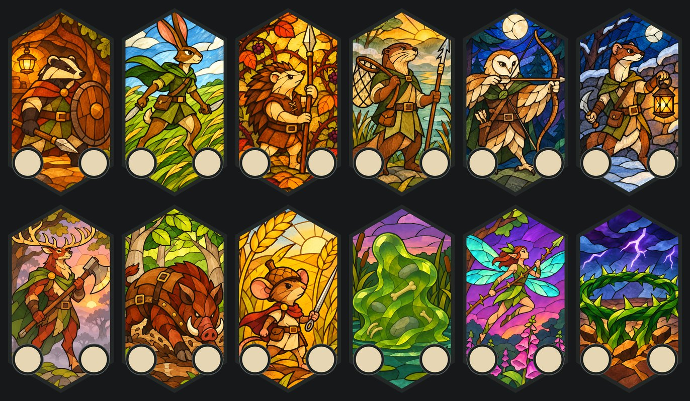

# Card art recipe: prompt, shape guide and assembly

**Approved by the owner for the stained glass branch, 16 November 2026.** Asked "Merge the recipe (PR 56) into the stained glass branch?", the owner said: "Yes, merge it". On 16 November 2026 the owner also approved it going to `main` with PR 55: asked whether to merge PR 55 "with the art recipe" to `main`, the owner said: "Let's do everything except 11 and 12" (this was item 1 of 12). Written 15 November 2026 from the tests run that day. The owner, on reading it: "I just want the existing process captured. I don't want it changed. ... This process is producing what I like." The card's shape is the L1 look's: its points take a regular hexagon's angles (L8), and its ratio stays 0.56, "the ratio that's already in the current game build that all the artwork is generated for" (L24; both in [../look-l1/decisions-l1.md](../look-l1/decisions-l1.md)).

What this is for, in the owner's words (15 Nov): "our goal out of this is to get reproducible guides for prompting and card assembly so that we get consistent results".

## The method in one paragraph

The **art** is a stained-glass picture of the fighter, made by Codex to the shape of a grey guide. It is moved into card space (560 × 1000) by one fixed crop and saved as the unit's card art. The **frame** is not a picture: the game draws one lead frame in code, the same at every tier and on every screen, and shows the middle of the art inside it ([../look-l1/buy-screen-l1.md](../look-l1/buy-screen-l1.md), section 6). Nothing is scaled, moved or cropped by hand.



## What the owner has decided

- **The prompt is the loose one.** After two rounds of rule-heavy prompts came out worse than the first fox picture: "that prompt is going to be our process for image generation going forward, I think."
- **Art and frame are made apart.** The owner's reason: "We don't want the borders influencing the image generation's algorithm's choice of color palette." It began as a suggestion, "So maybe we just ask it to generate it a little bigger and then just overlay the borders ourselves on the images. I'm not sure." After seeing it work the owner backed the method built on it (below).
- **Art is made to the frame's window.** "Giving it the shape is good, but that shape needs to be the exact shape that fits in the inside of our frame", so that "we won't ever have to worry about scaling the image, moving it, positioning it, and cropping it."
- **The guide's window is the plain tier frame's.** "the internal area for the simple frames that have the least thickness", "Ignoring any of the accents that get added and start overlaying onto the image in the higher tier frames."
- **This is the method to pursue.** "I think this approach is going to be the right method."
- **The borders change; the art does not, for now.** On 25 Nov 2026 the card's border became the L1 look's code-drawn lead frame. The owner: "I think card art replacement can happen later. We'll just replace the borders for now." (L51). The art in the game is unchanged, and art made by this recipe fits the new card (below). The calmer backgrounds and per-tribe colour guide the owner asked for on 24 Nov (L6) will change the prompt when that work starts; it has not.
- **Fighters are warriors, shown full body.** The owner, 14 Nov: "these are fighters. They're supposed to be warriors"; the art before was "far too big and zoomed in", with "Not enough ... actual arms and legs".
- **Roundels may cover a little.** "It's not a massive deal if feet and tails get covered a little bit".
- **The process stays as it is, lead and glass included.** Asked which stands, an earlier rule or the pictures: "I changed my mind on that rule. We're getting good results out of the existing stuff. So the existing process, like I just want the existing process captured. I don't want it changed."
- **Each fighter is shown against a named place,** as in every test picture. It is part of the process the owner asked to keep. Before glass was chosen the owner had also said "I want the art to feel like different tribes should have different biomes that they inhabit". Which tribe has which place is still open.

## What this replaces

The owner, 15 Nov: "If previous stuff I've said overrides it, call it out like that. And let's get rid of it because it's wrong." These earlier statements no longer hold:

- **"Lines need to be flat black. They can't be anything except black."** and **"The streaky stuff is not needed. And the painted stuff is also not needed."** (the owner, 15 Nov, in chat, before seeing the loose-prompt results). Withdrawn by the owner: "I changed my mind on that rule." The process gives dark brown lead and streaky, back-lit glass, and that is what is wanted. These two statements were never written into the repo.
- **The style-rules step of the dial-in plan** ([../../archive/glass-first-look/glass-dial-in.md](../../archive/glass-first-look/glass-dial-in.md), step 4): trials to settle painted detail, lead weight and glass texture, then rules written from them. Two rounds of those trials were run and came out worse than the loose prompt. No style rules are being written. The step is marked as replaced in the plan.

"The pieces", "Steps" and "What not to do" below are the process as it was run in the tests: the one the owner asked to have captured without change, with the card it is fitted to now the L1 card. The wording is the agent's. The test results and the "Not settled" list after them are the agent's report, not part of the process.

## The pieces

| Piece | Where | What it is |
|---|---|---|
| Card | [../look-l1/buy-screen-l1.md](../look-l1/buy-screen-l1.md), section 6; the numbers the game reads are in `assets/glass/l1/layout.json` (`card.*`) | Drawn by the game (`src/glass/glass_card.gd`, `l1_card_face.gd`): one lead frame, 5 px wide on a 140 × 250 card, round a window. The card shows the art file's source x 28 to 532, y 52 to 952 (504 × 900, a scale of 3.6 card units to a game pixel), so the card's outline in card units is (280, 52), (532, 197.5), (532, 806.5), (280, 952), (28, 806.5), (28, 197.5), and the window inside the lead is (280, 72.8), (514, 207.9), (514, 796.1), (280, 931.2), (46, 796.1), (46, 207.9). |
| Attack and Health | the same | Two discs, the same on every card: centres at (122, 791.8) and (438, 791.8) in card units, 61 units in radius, 76 with their rims. The game draws the numbers on them. |
| Art window and guide | `tools/art/glass-art/make_guide.py`, `guide.png`, `window.json` | The window the guide is drawn to: a six-sided shape 498 × 895 inside the 560 × 1000 card, (280, 52.5) to (529.1, 811.6), with 8 units added on every side. It is the window of the earlier tier frames, kept because art made to it covers the L1 card's window with room to spare. A plain grey panel in that outline, on Codex's 1024 × 1536 canvas. |
| Prompt | `tools/art/prompts/glass-art-window.txt` | The loose wording plus the list of subjects. |
| Codex worker | The `delegate_task` tool in a T3 Code thread | Starts a Codex worker that makes one batch, with the guide given by its path. |
| Check and preview | `tools/art/glass-art/assemble.py` | Measures each picture against the guide, and shows it in the game card's outline, with the window and the two discs, at 4 times and at 1 times game size. |
| Into the game | `tools/art/glass-art/prep_units.py` | Moves a picture into card space with the same crop and saves it as `assets/units/<tribe>/<unit id>.jpg` (560 × 1000). |

**The margins.** The window the card shows sits 22 card units or more inside the guide's art area on every side (14 or more inside the guide's window), and the card's outer edge 4 or more inside it. Codex returns the panel within about 7 canvas pixels (5 units) of the guide, so the art always fills the window. Outside the window the lead covers the art, and outside the outline nothing is drawn. The card sits on Codex's canvas at 1.44 times card-space size with its top-left corner at (108.8, 48). Measure again if the card's numbers in `assets/glass/l1/layout.json` change.

**The safe area.** What matters in a picture should sit inside the card's window, and clear of the two discs at its lower corners: they cover about x 46 to 198 and 362 to 514, from y 716 down. The card's window is 14 to 20 units inside the guide's window all round (most at the top point), so the guide's own edge never shows. A spell is shown as a disc, not a card: in the game its window is the circle inside source x 90 to 470, y 320 to 700 (spec section 6, "A spell in the hand"), so a spell's subject should sit in the middle of the picture. `assemble.py` draws every picture as a unit card.

## Steps

1. **Write the items.** Copy `glass-art-window.txt` and change only the numbered list at the bottom. One line per picture:

   `name.png -- A <animal> <role>, full body, <what it holds or is doing>, against <a place and a time of day>.`

   A spell has no fighter: `spell.png -- A spell, with no fighter in it: <what happens>, <where>.` Six items a batch works well.

2. **Run it with the guide,** in a Codex worker started from a T3 Code thread. Create the art folder first, outside the repo: on the PC a folder beside the project, on the Optiplex under `/data/bramble-art/`. Then call `delegate_task` with:

   - `target`: the Codex provider, with the model and effort the owner's `codex-workers` skill gives. The test used `gpt-6.2-sol` with `reasoningEffort` `high`; T3's own default effort is low.
   - `task`: these three lines, then the whole text of your prompt file.
     - `Working folder for this task: <full path of the art folder>. Where the text below says "the current working folder", it means that folder.`
     - `The shape guide that the text below calls "the attached image" is this file: <full path of tools/art/glass-art/guide.png>. Open it as an image first, and pass that file to the image tool as the reference for every item.`
     - `Do not run git or commit anything. Do not change any file in the repo.`

   The prompt file itself stays as it is: a task carries text only, so the guide goes by its path. T3 wakes your thread when the worker finishes. If `delegate_task` is not among your tools, the session is not running in T3 Code: run the batch from a thread that is.

   A batch of six takes about ten to fifteen minutes. Results differ from run to run, so run the same prompt two or three times into different folders and choose.

3. **Check and assemble.**

   ```
   python tools/art/glass-art/assemble.py <art folder> <cards folder>
   ```

   It prints, for each picture, how far the panel's four edges are from the guide's, and flags any that are more than 12 pixels off. The card's window has about 32 canvas pixels (22 units) of art to spare. The check measures the panel's left, top, right and bottom, not the sloping edges themselves. The guide is measured the same way as the pictures, so the guide itself reads 0 on every side. Make a flagged picture again. It then writes each picture in the game card's outline: `<name>.png` at 4 times game size, `<name>-game.png` at game size, and `sheet.jpg` with all of them. It is an outline for judging the art, not the game's look: the lead is flat, with no bevel, slab or light.

4. **Look at the cards** at the size they will be in the game (`<name>-game.png`), and check the safe area above.

5. **Put a chosen picture into the game** with `prep_units.py <tribe> <picture>[=<unit id>]`.

## What not to do

- **Do not add style rules.** Lead weight, lead colour, glass texture, piece counts and palette limits were all tried on 15 November. Codex followed them literally and the pictures came out flat. The two short paragraphs that begin "Look:" and "The design" are the whole style.
- **Do not attach a finished card as a style reference.** A reference locks whatever is in it. With a finished fox card attached, every picture copied its border and roundels. The grey guide works because there is nothing in it but the shape.
- **Do not put the border or the numbers in the art.** The game draws them.
- **Do not fit a picture by hand.** If it is off the guide, make it again.

## What the tests showed

| Test | Pictures | Result |
|---|---|---|
| Loose prompt, six fighters, three runs with nothing attached and three with the fox attached | 36 | The look came back every time. Without the fox, borders varied from run to run; with it, they were identical. |
| Art without a border, three ways | 54 | All three kept the quality. A border is not needed to get the look. |
| Art to the window with the grey guide, six fighters, three runs | 18 | Every panel edge within 5 pixels of the guide's, from 2 outside it to 5 inside. The set includes night scenes, and the check read them correctly. |
| The same with awkward subjects: a stag with wide antlers, a boar on all fours, a small mouse, an ooze, a fairy with wings spread, a spell | 18 | Every panel edge within 5 pixels, from 1 outside to 5 inside. All six made clear cards under all six tier frames. |
| Art to the thin frames' bigger window: the six fighters and the six awkward subjects, two runs each, through the repo's runner | 24 | Every panel edge within 7 pixels of the guide's. No gaps seen under any of the six thin frames as first cut. |
| The same again to a guide with a 12-unit margin, under the sharper frames | 24 | Every panel edge within 7 pixels of the guide's. No gaps seen under any tier, or along tier 5's upper sloping edges in a close-up of all 24. |
| The same again to the guide with the 8-unit margin, after tier 5 was redrawn | 24 | Every panel edge within 6 pixels of the guide's. No gaps seen under any tier on the sheet below, or along the upper sloping edges of tiers 4 and 5 in close-ups of all 24. |
| A stag, a boar and a mouse through the Codex bridge with the guide attached, when the bridge replaced the repo's runner (17 Nov) | 3 | Every panel edge within 2 pixels of the guide's. |
| The same three through a T3 Code Codex worker (`gpt-6.2-sol`, high effort) with the guide given by its path, when T3 replaced the bridge (18 Nov). Run on the PC from a full-access thread; not run on the Optiplex or from a thread with narrower access | 3 | Every panel edge within 2 pixels of the guide's. The worker said it passed the guide to the image tool as a reference. |

The two 18-picture tests were made to an earlier, smaller window, for thicker frames that have since been replaced. The first 24-picture test used a guide with a 4-unit margin; under the sharper frames that left a thin gap on tier 5's upper sloping edges, so the second used a 12-unit margin. The owner then had tier 5 redrawn to match the other tiers (below), and the agent set the margin to 8, not the original 4: the sharper frames' windows sit 1.6 to 3.3 units inside the art window where the first thin set's sat 7 or more, so a margin of 4 would leave about 8 pixels of art under the border against Codex's error of about 7. The third 24-picture test uses the guide and frames described here.

Before the frames were thinned, the steps above were also run once exactly as written, to the earlier window, through the repo's runner and `assemble.py`, for a fighter not used before (a heron). The panel came back within 1 pixel of the guide and the cards assembled with no changes.

The tests up to 18 Nov were judged under the six tier frames the game drew then (the frames and those pictures are in [../../archive/glass-first-look/](../../archive/glass-first-look/ARCHIVED.md)). Twelve pictures from the third 24-picture test, in the L1 card's outline as `assemble.py` draws it (25 Nov); the last is a spell, which the game shows as a disc:



The full sets are on the Optiplex under `/data/bramble-art/stained-glass/` (`loose-prompt-test`, `window-art-test`; the three 24-picture sets are in `window-art-test/thin-frames`, `window-art-test/sharp-frames` and `window-art-test/margin-8`; the last holds the current pictures and cards).

## Not settled

- **The discs cover the lower corners.** Feet and tails often sit behind them. The two discs could be added to the guide so Codex keeps clear of them.
- **The guide is the earlier frames' window.** It works for the L1 card (the margins above), but it is not the L1 card's own outline. A guide drawn to the L1 window would give Codex the exact shape; nobody has tried one.
- **A large set has not been made.** The most made to one guide is 24, in four batches of six. Colour strength varies a little between runs, and that may show across a hundred cards.
