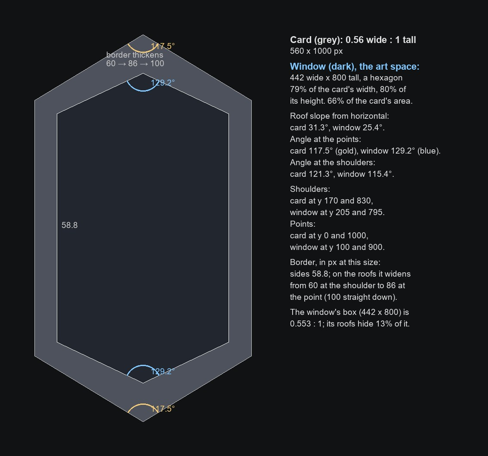

# The art space inside a 0.56 card

The card shape was locked at 0.56 wide to 1 tall by the owner on 15 Nov 2026. The art space is the whole window inside the border: a hexagon whose roofs are flatter than the card's own. The Attack and Health roundels are left out on purpose; this page is only the shape.

Measured from the 0.56 frames (rounds 1b and 1c) and made symmetric top to bottom. Codex drew the bottom a few pixels different from the top; that's drift, not design. Pixels are for a 560 × 1000 card.

## Points

| | Top point | Top shoulders | Bottom shoulders | Bottom point | Sides |
|---|---|---|---|---|---|
| Card | (280, 0) | y 170 | y 830 | (280, 1000) | x 0 and 560 |
| Window | (280, 100) | y 205 | y 795 | (280, 900) | x 58.8 and 501.2 |

Machine-readable: [card-0.56.svg](card-0.56.svg) (both polygons), [mask-window-0.56.png](mask-window-0.56.png) and [mask-card-0.56.png](mask-card-0.56.png) (white shape on black, 1120 × 2000).

## Angles

| | Roof slope from horizontal | Angle at the points | Angle at the shoulders |
|---|---|---|---|
| Card | 31.3° | 117.5° | 121.3° |
| Window | 25.4° | 129.2° | 115.4° |

The window's points are blunter than the card's (129° against 117.5°), so the border is wider along the roofs than down the sides.

## Size

- **Window:** 442 wide × 800 tall. That's 79% of the card's width and 80% of its height, and 66% of the card's area.
- **The window's bounding box** is 0.553 wide to 1 tall, almost the card's own shape. The roofs take up 13% of that box.
- **Border thickness:** 58.8 down the sides. Measured square to the roof, it widens from about 60 at the shoulders to 86 at the points, and it's 100 measured straight down at the points.

## For the art

- A picture that fills the window's box (442 × 800, or 0.553 to 1), plus a little extra under the lead, covers the whole window with nothing wasted except the four roof corners.
- At any other size, scale the picture so the window's box fits inside it, centred.
