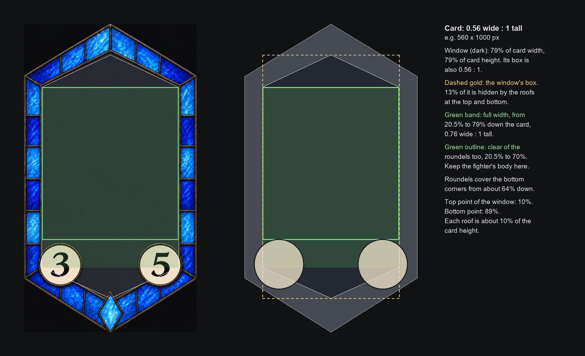

# The art space inside a 0.56 card

Measured from the 0.56 frames (rounds 1b and 1c). The card shape was locked at 0.56 wide to 1 tall by the owner on 15 Nov 2026. The figures are fractions of the card's width (W) and height (H), with pixels for a 560 x 1000 card in brackets.

## The card

- **Outline:** 0.56 wide to 1 tall.
- **Shoulders**, where the roof meets the vertical sides: 17% down from the top and 17.5% up from the bottom (y 170 and 825).

## The window (the art space)

- **Width:** 79% of the card (442 px). The side border is about 10.5% of the card width on each side.
- **Height, point to point:** 79% of the card (790 px). The top point is 10% down (y 100) and the bottom point is 89% down (y 890).
- **Its bounding box is also 0.56 wide to 1 tall:** the same shape as the card, at 79% of the size.
- **The roofs are flatter than the card's.** Each roof of the window rises about 10% of the card height, from its point to its shoulder. The card's own roof rises 17%. The difference is what makes the border thicken towards each point.
- **The window's shoulders** sit 20.5% down (y 205) and 79% down (y 790). Between them the window is full width: a rectangle 79% wide and 58.5% tall (442 x 585), which is **0.76 wide to 1 tall**.
- **About 13% of the bounding box is hidden** by the four roof corners.

## What the roundels cover

- The Attack and Health roundels sit at 20% and 80% across and 78% down, each about 29% of the card width across (diameter 162 px).
- They cover the window's bottom corners from about 64% down.
- **The clear area,** full width and clear of the roundels, runs from 20.5% to 70% down: 442 x 495, about **0.9 wide to 1 tall**. That's where the fighter's body should sit. The head can rise into the top roof, and feet and ground can run down between the roundels.

## What this means for the art

- **The best picture shape is 0.56 wide to 1 tall,** the same as the card, sized to the window's box plus a small bleed under the lead (about 2% on each side).
- **A 2:3 picture** (0.67 wide to 1 tall, the shape of the current border-free art) fitted to the window's height loses about 8% of its width on each side.
- **For any picture,** keep the fighter centred, with its body between 20% and 70% down the card. Treat the top and bottom 20% as sky and ground that the roofs will cut.
