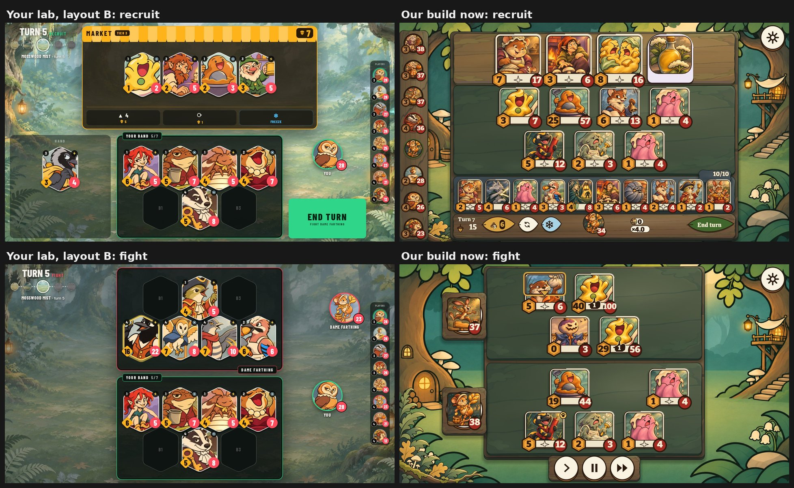

# Your journey lab beside our build (11 Nov)

The owner's lab: `docs/design-lab/journey/HANDOFF.md` on branch `design-lab/journey`. It's an HTML mock-up of Clean Arena layout B, with 12 layout rules.

The owner's words (11 Nov):

> "These aren't hard rules, but look at these, have reviewers have a look at them, see what they think… see where there's some similarity and see if this changes your plans at all and give me a report."

Two fresh Codex reviewers looked at it:
- `report-fresh-eyes.md` judged the lab beside The Bazaar, Battlegrounds and TFT.
- `report-compare.md` went rule by rule against our build and its code.

A Fable advisor then checked the proposed plan.

## Yes, it changes the plan

Layout B becomes the base for the game's layout, in place of Bazaar Stack. The framed surfaces from step A2 carry over.

## Where we landed on the same things

We reached these on our own:
- Play sits on framed surfaces, with the world as a frame around it. The shop and the board are separate areas.
- Your board is centred left to right.
- The board is 4 in front and 3 behind, with the back row offset by half a slot.
- Rules text appears only in a reader, on hover or tap. The main screen carries little text.

## Where we went the other way

On these we followed The Bazaar's bottom bar:
- **Your board moves.** It moves and resizes between recruit, scouting and fight. In your lab it never moves.
- **Units come in three sizes.** They're big in the shop, medium on the board and small in the hand. Yours are one size everywhere.
- **The shop buttons are in the bar.** Tier-up, refresh and freeze sit in the bottom bar. Yours are inside the market.
- **The other players are on the left.** Yours are a slim strip on the right, centred top to bottom.
- **The boards lose height.** The hand takes a full-width row and the bar takes another. You put the hand left of the board and the hero and End turn right of it, so the boards keep the height.
- **Smaller differences:** our units are rounded cards, not hexes, and we have one backdrop, not areas that change as you travel.

## What the reviewers said

**Both reviewers' first point: keep the fixed board and the buttons inside the shop.** Together they make it clear what's yours and what changed between phases.

**Problems the lab doesn't solve yet:**
- **A full hand of 10.** The lab stops at 4 cards in hand. With 10, six fell below the screen. "One size everywhere" and a 10-card hand pull against each other, so the hand will need to overlap.
- **The shop.** It can show more offers than the lab's market fits at unit size.
- **Big numbers.** Three-digit stats overflow the badges.
- **Keywords.** The generic ability icon doesn't say which keyword a unit has.
- **Phone.**
  - Tapping a unit flips it to show its rules in tiny text.
  - At 1688×780, scaling the whole screen down isn't enough. It needs its own layout rules.
- **Missing screens.** The lab has no scouting, and no standings during the fight.
- **Compared with The Bazaar:**
  - The End turn button is oversized.
  - Attention splits three ways (hand, board, buttons), where The Bazaar gives one reading path.

Some of these our build already solves: the full hand, the card reader and scouting. Those solutions carry into layout B.

## The plan when you say resume

1. **Merge B, the recruit feel.** First fix its one failing test in the code: it may be a real bug, where the reader calls into a node that's already freed. B's drag and reader work carries over to any layout.
2. **A3: layout B's arrangement in the engine.**
   - One fixed board for recruit, scouting and fight.
   - Gold and the three buttons inside the market.
   - The standings as a strip on the right.
   - The hand to the left: it overlaps and holds 10.
   - The hero and End turn to the right.
   - Turn and route at the top left.
   - One unit size for the shop, the board and the opponent's board.

   The board is sized for hexes from the start. At 1080 tall the hex tuck saves only about 29 px, so nothing has to be redone when the hexes arrive.
3. **A4: hex units** in your chosen shape, between the mid hex and the tall hex.
4. **Later: areas that change as you travel.** This is backdrop only, with no rules.

## What the advisor changed

I had planned to restart B and A3 straight away and push A3 in before the merge freeze. The advisor pointed out two problems:
- You had said to pause.
- A3 is a medium-sized change, and its hard parts aren't designed yet: the 10-card hand, phone and scouting.

So none of this starts until you say so, and A3 doesn't go in before the freeze.

## Your call

Loop 1 was due to end with you playing its build on 13 Nov.
- **Shipping on 13 Nov:** you'd play Bazaar Stack, plus two small moves (buttons into the market, standings to the right). You've already moved past that layout.
- **Waiting:** you'd play layout B in the game, roughly two days after you say resume.

I'd wait.
